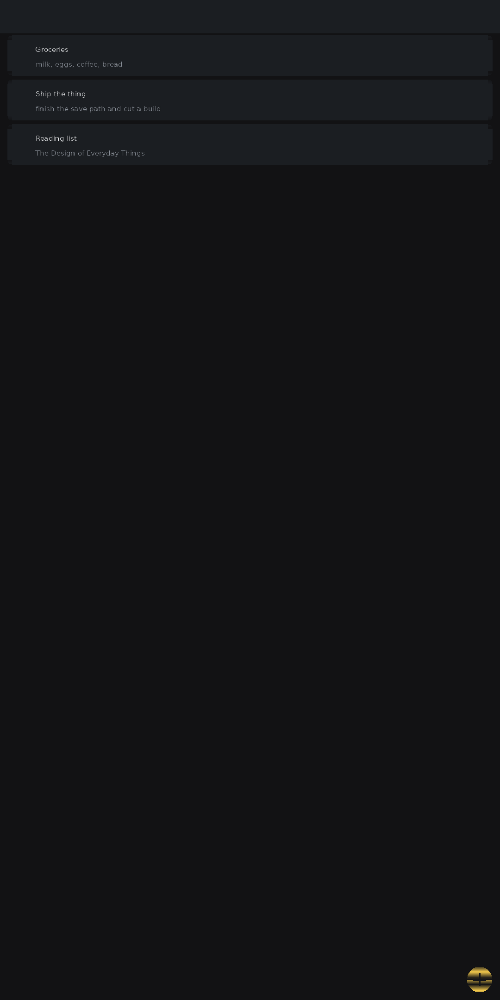

# NOTA

A notes app for Android written entirely in AArch64 assembly.

NOTA has no Java, no Kotlin, and no C beyond a 200-line shim that calls
`ANativeActivity_onCreate`. Every screen, text run, keystroke, byte of UTF-8 and
byte of the save file is handled by `src/*.S`. The APK is ~150 KB, has
`hasCode="false"`, minSdk 26 and asks for no permissions.



The screenshot is not a mock-up: it is painted from the quads the real
`nota_screen_list` emits, sampling the real baked atlas, at 1080x2160.

## What it does

- **Notes list** — scrollable, tappable cards; one card per note.
- **Editor** — multi-line text with a real caret, UTF-8 aware, insert/delete at
  the cursor, backed by a growable document buffer.
- **Persistence** — the collection is written to `internalDataPath/notes.db` on
  pause and reloaded on launch. Writes are crash-safe and checksummed.
- **Rendering** — one GL ES 2 program, a baked 200-glyph font atlas, batched
  coloured quads. No text-shaping library, no FreeType, no fonts at runtime.

## Install the prebuilt APK

`nota-1.0.0.apk` in the repository root is a built copy of this source
(146 KB, arm64-v8a):

```sh
adb install nota-1.0.0.apk
```

It is **debug-signed** and targets arm64 only, so it installs on a real 64-bit
ARM device over adb but not on an x86_64 emulator, and it is not Play Store
distributable. A release build needs a private keystore
(`build.py --key … --cert …`). Verify the download against
`nota-1.0.0.apk.sha256`.

## Build

Requires Python 3 and a cross-compiler that targets `aarch64-linux-android`.
`build.py` is the only entry point; it needs no Gradle, no SDK, no NDK.

```sh
python3 build.py --cc "zig cc -target aarch64-linux-android"
python3 tools/apksign.py verify --apk out/nota.apk
```

`--cc` takes the compiler command; `zig cc` is what this repository is
developed against, but any clang that targets Android will do. The build drives
the whole pipeline itself:

| Step | Handled by | Notes |
| --- | --- | --- |
| NDK headers | `tools/mkstubs.py` | generates only the entry points NOTA actually calls |
| compile | the `--cc` compiler | 14 `.S` files plus `app/glue.c` |
| link | `ld.lld` via the compiler | `-shared -nostdlib -fPIC`, soname `libnota.so` |
| `AndroidManifest.xml` | `tools/axml.py` | binary XML, written from Python |
| `resources.arsc` | `tools/arsc.py` | one launcher icon, `0x7F020000` |
| zip layout | `tools/zipw.py` | `libnota.so` STORED and page-aligned at 4096 |
| signing | `tools/apksign.py` | APK Signature Scheme v2, then self-verifies |

The native library must be STORED (not deflated) and page-aligned for
`extractNativeLibs="false"` to mmap it straight out of the APK; `zipw.py`
exists for that constraint alone.

## Tests

There is no emulator and no device in the loop. `tests/a64.py` is an AArch64
interpreter — integer, scalar FP, the addressing modes NOTA emits — and
`tests/sysemu.py` is a small kernel behind it: `open`/`read`/`write`/`rename`/
`fsync` over an in-memory filesystem, so persistence is tested by actually
writing and re-reading files.

```sh
python3 tests/run_tests.py    # libc, utf8, editing, store: 51
python3 tests/test_decode.py  # instruction decoding: 48
python3 tests/test_ui.py      # layout, text, screens, save/load: 40
python3 tools/checkabi.py     # static ABI checks over src/*.S
python3 tools/shot.py         # re-render docs/screenshot.png
```

`checkabi.py` is the fourth suite: it reads the assembly and enforces rules
that a compiler would normally enforce and an assembler does not. It catches
clobbered argument registers, stack slots that alias each other, `adrp` without
its matching `:lo12:`, `.section` directives never switched back, `ldr x` on a
32-bit field, and internal symbols missing `.hidden` in a PIC object (which
breaks the shared library at load time, not at link time).

## Layout

```
src/nota.h        every ABI offset and size, with .if assertions
src/main.S        _start, JNI entry, animator glue
src/lifecycle.S   ANativeActivity callbacks
src/callbacks.S   app init (load), input dispatch
src/app.S         note model, arena allocator, collection state
src/store.S       serialisation, CRC-32, crash-safe file replacement
src/sys.S         bionic syscall wrappers
src/libc.S        memcpy/memset/strlen/... for the freestanding build
src/utf8.S        encode/decode/validate
src/edit.S        the document buffer and cursor operations
src/text.S        glyph lookup, advance, emit
src/font.S        generated: 200 glyphs, 16x20, 208x320 atlas
src/tex.S         GL ES 2 pipeline, quad batching
src/ui.S          layout, hit-testing, rounded rectangles
src/screen.S      the list screen and the editor screen
app/glue.h        NDK declarations, offset-asserted
app/glue.c        the only C: hands the activity to assembly
```

## The save format

```
"NOTA" | u32 version=1 | u32 count | record*
record = u32 len | u32 crc32 | payload
payload = u32 id, flags, folder, tag_count | u64 created, updated
        | u32 title_len, body_len | title | body | tag ids
```

Deliberately boring: fixed-width little-endian fields, a length and a checksum
per record, and no pointers. Loading validates before trusting anything, so a
truncated or corrupt file fails at the first bad record instead of being
half-applied. A missing file is not an error — a first launch comes up empty
rather than refusing to start.

Saving goes through a temporary file and a `rename`, so a process kill
mid-write leaves the previous save intact:

```
notes.db  ->  notes.db.bak
write notes.db.tmp  ->  fsync  ->  close  ->  rename(tmp, notes.db)
```

The dirty flag is only cleared once the rename succeeds, so a failed save is
retried on the next pause instead of being quietly forgotten.

## Why

Assembly is a poor choice for a notes app, which is why the interesting part is
everything around it: the interpreter that lets it be tested without a device,
the ABI checker that substitutes for a type system, and the build that has no
toolchain dependencies beyond a cross-compiler.

The parts of `src/` worth reading are `store.S` (the only place that has to be
right about bytes) and `text.S` (glyph lookup by binary search over a sorted
table of strays).
